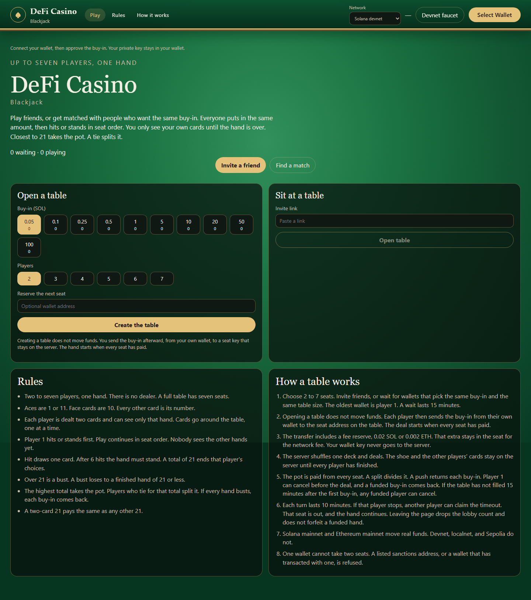
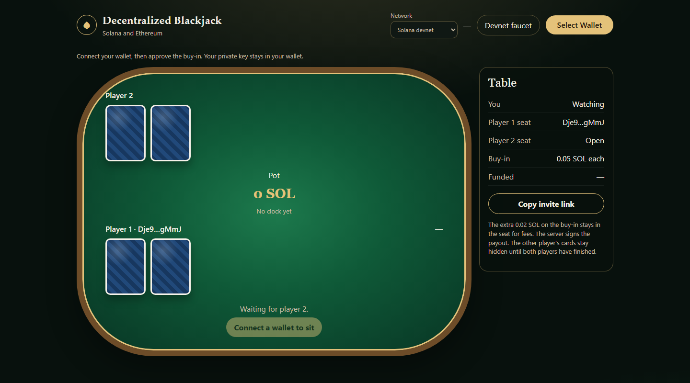
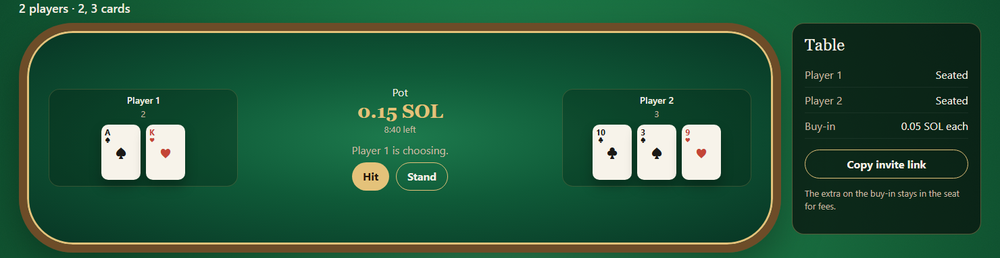
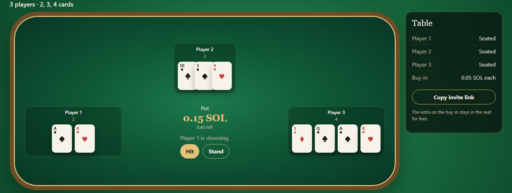
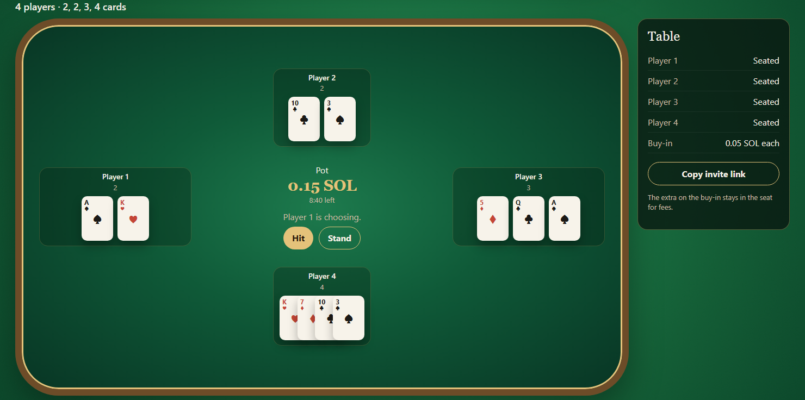
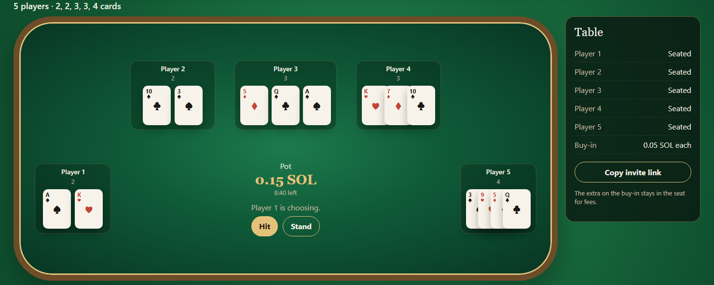
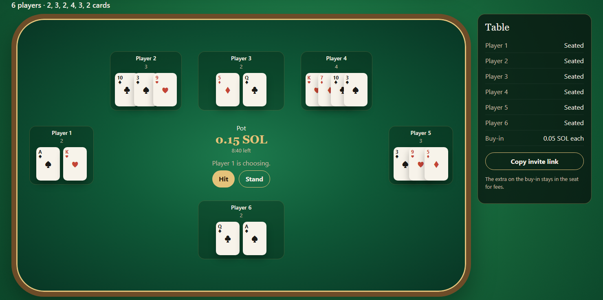
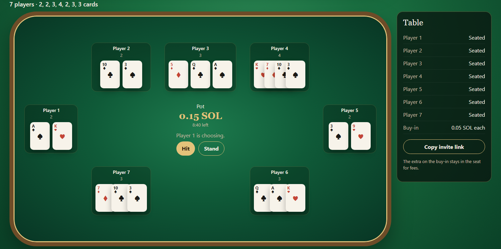
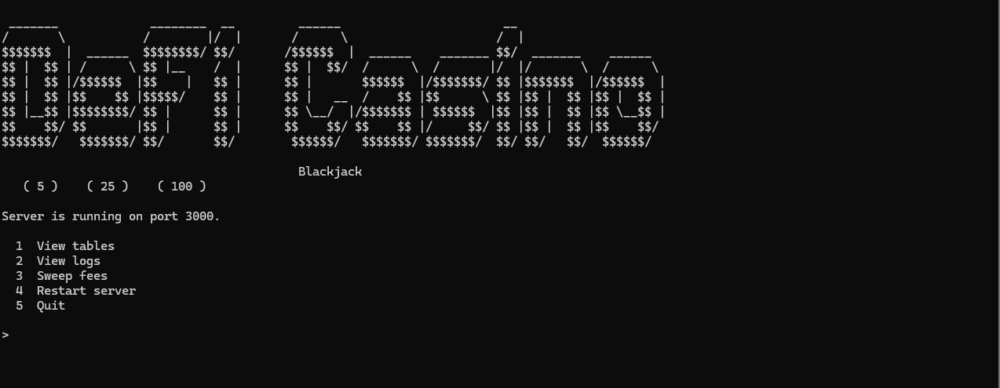

# Blackjack





Two wallets sit at one table on Solana devnet, Solana mainnet, Solana localnet, Ethereum Sepolia, or Ethereum mainnet. Each sends the same buy-in to a seat the server creates. They play one hand. The server pays the winner from those seats. A tie sends both buy-ins back. Mainnet moves real SOL or real ETH. Devnet, localnet, and Sepolia do not.

There is no dealer. Both players choose hit or stand. Each player sees only their own cards until both have finished. The higher total takes the pot. A bust loses to a finished hand, and two busts or two equal totals send both buy-ins back. A 21 is a 21 whether it took two cards or more.

## Card configuration

A table seats two to seven players. The seats sit around the pot. Two players sit on the left and right. Three adds one across the top. Four adds one along the bottom. Five puts three across the top, a step higher than the other counts, with one player on each side. Six adds one seat under the pot. Seven adds a second seat along the bottom. A longer hand stays in that seat. The pictures below are sample hands, not a live table.













## Where the secrets live

The shoe, the other player's cards, the undealt cards, and the seat private keys are stored in Supabase. With `ARGON2_PASS` set, each new seat key is stored as `enc:v2:` ciphertext, not as the raw key. The browser receives the cards it is allowed to see and an httpOnly session cookie. It does not receive a private key or the rest of the deck. `web/data/` is not committed. It still holds the activity log, the table archive, the sanctions caches, and sweep records.

You can invite a friend, or pick a buy-in and wait for another wallet that wants the same stake on the same network. The choices are 0.05, 0.1, 0.25, 0.5, 1, 5, 10, 20, 50, and 100. The lobby shows how many wallets are waiting and how many are at a table right now. Each wallet counts once. Leaving the table, or staying quiet for 20 seconds, drops that seat from the count. The hand itself stays until the usual timeout. The first person in line is player 1. The second is player 2. A wait expires after 15 minutes. On an invite table, once at least two people have sat, everyone sitting can vote to start with that smaller group. The open seats close, and the buy-in clock starts. Solana mainnet and Ethereum mainnet check that the wallet holds the buy-in before it sits or enters the queue. On a table of three or more, a paid player can type `/kick` and a name in the chat. The named player must not have paid. More than two paid players are required, and a majority of them have to agree before that seat opens.

Before a wallet can join the line, sit, or be paid, the server checks it against the digital-currency addresses on the U.S. Treasury OFAC SDN list. It also reads that wallet's transaction history. Listed addresses are published for Ethereum mainnet and Solana mainnet, so every wallet is read against that history. A mainnet table also sends the buy-in and the payout on that network. A devnet, localnet, or Sepolia table does not. A listed address, or a transfer with one, is refused. If the list or the history cannot be loaded, the wallet is refused too. A history longer than 2,000 Solana signatures or 2,000 Ethereum transfers is refused when the check cannot finish it. A clear result only means that exact address is not published on the list and no listed address appeared in the history that was read.

Your own wallet key stays in Phantom, Solflare, MetaMask, or WalletConnect. The wallet only signs the buy-in transfer to the server seat. The server cannot see that key. The server can move the buy-in, because it holds the seat key. That is the tradeoff for dealing away from the browser. Choose the network before anyone sends a buy-in. Mainnet cannot be undone.

A player who stops acting for 10 minutes is out of the hand. Another player can claim the timeout. The claimant still has to have a hand of 21 or less to win: if every hand left in is a bust, every buy-in goes back, including the one from the player who timed out.

The first buy-in starts a 15 minute wait. If the table has not filled and funded by then, any player who has paid can cancel it, and every paid buy-in is sent back. Player 1 can cancel at any time before the deal. Once every seat is taken, that wait becomes a 5 minute buy-in clock. The deal starts when every seat has paid. If the clock runs out first, any player who has paid can cancel, and every paid buy-in is sent back.

## Running it with real money

Set these on the server before opening a mainnet table:

- `ARGON2_PASS`, at least 32 random characters. The server stretches it with Argon2id and encrypts each seat private key with that key before the row is written. The database stores the ciphertext (`enc:v2:`), not the key and not a hash of the key. A hash cannot pay a seat. Keep a copy of the password somewhere else: a seat sealed with one password cannot be opened with another. `ARGAON2_PASS` is read too, if that is the name that was set. `SEAT_KEY_SECRET` still opens older `enc:v1:` seats. Without either value the server refuses Solana mainnet and Ethereum mainnet tables. Test networks may store a seat in plain text until one of them is set.
- A reverse proxy that sets `x-forwarded-for` itself. The request limits count by that address. Without a proxy, every caller shares one limit, or can pick their own address by sending the header.
- HTTPS. In a production build the session cookies are only sent over HTTPS.

More than one server process on the same machine can share one Supabase project and one `web/data/` folder. Writes to the store take `data/tables.json.lock`, and each table's payout takes `data/cashier/<table>.lock`, so only one process pays a table. A lock left by a process that exited is taken over. Do not point two machines at the same database without that lock: a lock from another host is never taken over, so a payout saved on one machine can be overwritten by the other. Request limits are still counted per process.

Each payout is signed and saved before it is broadcast. A retry looks up the saved transfer first. It sends the same bytes again while the transfer can still land, and builds a new one only after the chain shows the old one never can: past its blockhash on Solana, or mined and failed on Ethereum. If an Ethereum seat's nonce was used by a transfer the server has no record of, nothing is sent and the table shows an error for the operator.

A table that nobody funded leaves the live database after a day. One saved before that clock existed, still with no buy-in, leaves the next time the lobby or the admin list is read. A fully paid table leaves after a week. They are appended to `web/data/tables-archive.jsonl` with their seat keys, because a seat can still hold the fee buffer. Nothing deletes that file.

The fee reserve left in a seat can be sent to a master wallet. The server stores that wallet's address only. Its private key stays with you, offline. Put the address in `web/.env.local` (`SWEEP_SOL_ADDRESS` for Solana, `SWEEP_ETH_ADDRESS` for Ethereum). From `web`:

```
npm run sweep -- mainnet
npm run sweep -- mainnet --send
```

The first command only prints what would move. It does not decrypt seat keys. `--send` decrypts each seat it pays, one ciphertext at a time, then signs the transfer. An `enc:v2:` seat needs `ARGON2_PASS`. An `enc:v1:` seat needs `SEAT_KEY_SECRET`. A seat is included only after the hand is settled or cancelled and every payout from that seat has landed. The transfer is at most the recorded reserve, minus the network fee. Any larger balance stays in the seat. The signed transfer is saved in `web/data/sweeps.json` before it is broadcast, so a second run does not send it again. A seat whose payout is still in progress is skipped.

## Admin console



From `web`, `npm run admin` opens the operator console. It reads `web/.env.local` and `web/data` on this machine and exits when you quit. With `SUPABASE_STORE=on`, the table list comes from Supabase. The game server is separate: `npm run dev` while you are working, or `npm run build` and then `npm start` in production.

The menu is:

1. View tables. Active lists live tables that are waiting or in a hand. Completed lists settled and cancelled tables, including ones already moved to the archive. Each row shows the id, network, phase, buy-in, funded seats over the seat count, payout, and whether the row is still live or in the archive. `0/2` means nobody has paid on a two-seat table. Seat keys and the shoe are left out.
2. View logs. The last 50 lines, or the last 200.
3. Sweep fees. Choose Solana devnet, Solana mainnet, Solana localnet, Ethereum Sepolia, or Ethereum mainnet. Dry run only prints. Send asks you to type `send`, then follows the same rules as `npm run sweep`.
4. Restart server. If this app is listening, type `restart`. If it is not, type `start`. That stops only a Next process whose command line is this `web` folder, then starts `next dev` again. The port is 3000, or `PORT` when that is set. Hands stay in the database. A production `npm start` process would come back as the development server, so leave production restarts to the process manager.
5. Quit. `q` and `quit` also leave.

The same actions run without the menu:

```
npm run admin -- tables active
npm run admin -- tables completed
npm run admin -- logs
npm run admin -- logs 200
npm run admin -- sweep devnet
npm run admin -- sweep mainnet --send
npm run admin -- restart --yes
```

`logs` prints the latest lines. The number can be from 1 to 1000, and it is 50 when left off. `activity` is another name for `logs`. A direct sweep with `--send` does not ask again. `restart` runs only when `--yes` is present.

Committed actions are appended to `web/data/activity.jsonl`. That is a join (opening a table, taking an invite, or a match), a leave when that player closes the page, hit, stand, cancel, claim, a buy-in the first time its transfer is recorded, each payout when it lands, and the fee reserve still held in that seat afterward. A sweep is logged only when `--send` moves the reserve to the master wallet. Presence polls are not logged. The file has no seat keys and no shoe.

## Program

`GtkZUSisZjxGFNamJTEEZNCndUaJX9sMSm6tTgu9yAsv`

Buy-in is 0.01 to 50 SOL per seat. The player also pays rent for the table account (about 0.015 SOL) and can reclaim it after the hand. Cancel is only available before the dealer sits, and it returns the buy-in and the rent.

| Instruction | Who signs | What it does |
| --- | --- | --- |
| `create_game` | Player | Opens the table, stores 16 commitments, deposits the buy-in |
| `join_game` | Dealer | Matches the buy-in and stores 16 commitments |
| `cancel_game` | Player | Refunds an empty table |
| `dealer_reveal_opening` / `player_reveal_opening` | Each seat | Deals two player cards and the dealer upcard |
| `hit` / `stand` | Player | Locks the decision |
| `dealer_reveal_hit` / `player_reveal_hit` | Each seat | Draws the locked hit. A bust owes the pot to the dealer |
| `dealer_reveal_showdown` / `player_reveal_showdown` | Each seat | Deals the hole card, plays the dealer to 17, and records each seat's share |
| `withdraw` | Player or dealer | Takes that seat's share of a resolved hand, to any account the signer names |
| `claim_timeout` | The seat that is waiting | Takes the pot after 10 minutes of silence |
| `close_table` | Player | Reclaims table rent once both seats have withdrawn |

Settlement records what each seat is owed and transfers nothing. A failed transfer reverts the whole Solana instruction, so if the showdown paid both seats, one seat could leave its wallet unable to receive and the hand could never resolve. Each seat withdraws its own share instead. `claim_timeout` and `cancel_game` still pay directly, because the only wallet they pay is the one signing.

The table account grew by 16 bytes for the two amounts, so this is a new layout. Tables made by an earlier deployment cannot be read by this one.

The dealer hole card is not written into the account until showdown, so the player sees one dealer upcard while they act.

This program has not been audited and is not what the running app uses to deal. The server deals the hand. Solana play stays on devnet and localnet. Ethereum play stays on Sepolia.

## Run the table

The web app needs Node.js 20 or newer. Hands are stored in Supabase. Create a project, open the SQL editor, and run `web/supabase/schema.sql`. That creates `game_tables`, `game_sessions`, `game_queue`, `profiles`, `profile_results`, and `chat_messages`, turns on row-level security, and grants the game tables to `service_role` only. The publishable key cannot read seat keys, the shoe, or profiles. It can read table chat so Realtime can deliver new lines. The server is the only writer. Run the file again when a new table is missing. Existing game tables stay in place.

Put the project URL and keys in `web/.env.local`. That file is not committed. Use the secret key from the dashboard, the one that starts with `sb_secret_`, not the publishable key.

```
SUPABASE_URL=https://your-project.supabase.co
SUPABASE_PUBLISHABLE_KEY=sb_publishable_...
SUPABASE_SECRET_KEY=sb_secret_...
SUPABASE_STORE=on
ARGON2_PASS=at least 32 random characters
```

`SUPABASE_STORE=on` is what makes the server use the database. Leave it unset and the server keeps hands in `web/data/tables.json` instead. The first time the database is empty and that file already has tables, the server copies the file in and then leaves it. Later writes go to Supabase only.

`ARGON2_PASS` needs at least 32 random characters. Keep a copy off the machine. The server stretches it with Argon2id, 19 MiB and 2 passes, and encrypts every new seat key with AES-256-GCM before the row is written. The stored string starts with `enc:v2:` and then the salt, the nonce, the tag, and the ciphertext, each in base64. The salt is part of that string, 16 random bytes for that seat, not a separate setting. A restarted process opens those seats with this password and this code. Nothing else has to survive the crash. `SEAT_KEY_SECRET` is only for older `enc:v1:` seats. Without either value, a devnet, localnet, or Sepolia seat is stored in plain text, and a mainnet seat is refused.

```powershell
cd web
npm install
npm test
npm run dev
```

Restart `npm run dev` after changing `web/.env.local`. Next reads that file when the process starts.

Open http://localhost:3000. Solana mainnet is selected, and Ethereum mainnet is the next choice. For a free hand, choose Solana devnet in that menu, or open http://localhost:3000/?chain=devnet, set the wallet to Devnet, and use the airdrop button or [the public faucet](https://faucet.solana.com). Create a table in one browser profile and open the invite link in another.

The on-chain program has to be deployed before a hand can be funded. Building it needs Rust, the Solana CLI, and Anchor 1.2.2. On Windows, WSL is the reliable way to run `anchor build`.

```bash
cargo test -p blackjack-logic
cp programs/blackjack/blackjack-keypair.json target/deploy/blackjack-keypair.json
anchor build
anchor deploy
```

The keypair in `programs/blackjack/blackjack-keypair.json` is the program address, not a funded wallet. `declare_id!` in `programs/blackjack/src/lib.rs` matches it. A new keypair would deploy a different program, and the web app would not find the tables.

`NEXT_PUBLIC_RPC_URL` overrides the devnet RPC used by the app.

WalletConnect appears in the wallet list on devnet. Create a project at [cloud.walletconnect.com](https://cloud.walletconnect.com) and put the id in `web/.env.local`:

```
NEXT_PUBLIC_WALLETCONNECT_PROJECT_ID=your_project_id
```

Restart the dev server after saving that file. Localnet has no WalletConnect chain.

## Ethereum Sepolia

`contracts/Blackjack.sol` is the same hand: both seats commit 16 SHA-256 card secrets, the dealer stands on every 17, and the winner takes the pot. The app can connect MetaMask or WalletConnect and read a Sepolia balance before that contract is deployed. Creating a table needs the deployed address.

The network list sends nothing on Ethereum mainnet. A wallet on mainnet is asked to switch to Sepolia before a transaction. If it refuses, the request stops.

This repository does not deploy the contract. After you deploy `Blackjack.sol` to Sepolia yourself, add the address and restart the dev server:

```
NEXT_PUBLIC_ETH_BLACKJACK_ADDRESS=0x...
NEXT_PUBLIC_ETH_RPC_URL=https://ethereum-sepolia-rpc.publicnode.com
```

Buy-in is 0.01 to 50 ETH per seat. There is no table rent. Cancel before the dealer sits and the buy-in comes back. Test ETH comes from a Sepolia faucet, such as [Alchemy's](https://www.alchemy.com/faucets/ethereum-sepolia). Open a Sepolia table at `http://localhost:3000/?chain=sepolia`.
